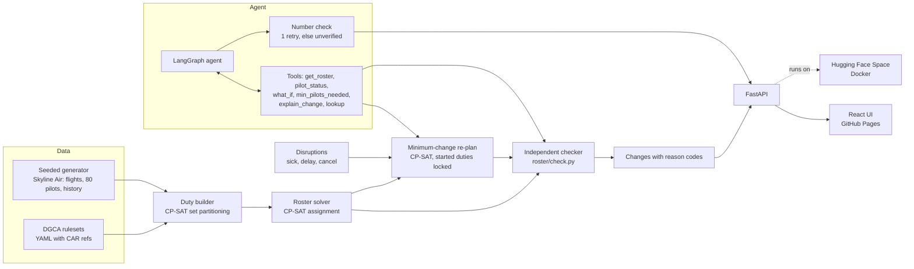

# Crew Roster Copilot

A DGCA-compliant pilot rostering system for a fictional airline, **Skyline Air**. A CP-SAT optimiser builds a 7-day roster for 80 pilots at two bases. When disruptions hit (sick pilots, delays, cancellations) it re-plans with as few changes as possible. An independent checker verifies every roster against the rules. A LangGraph agent answers what-if questions by calling the optimiser, and every number in its answer is checked against tool output.

| | |
|---|---|
| **Optimisation** | OR-tools CP-SAT: duty building as set partitioning, then roster assignment; minimum-change re-planning |
| **Verification** | One legality checker, separate from the solver, is the single source of truth |
| **Agent** | LangGraph tool-calling agent on Claude Haiku 5.5 (or Groq gpt-oss), with a number-check guard and one retry |
| **Evaluation** | 50-scenario optimiser benchmark (CP-SAT vs greedy vs from-scratch), crew sizing, agent eval harness |
| **Serving** | FastAPI in Docker on a Hugging Face Space, React UI on GitHub Pages |

**Not affiliated with any airline. Skyline Air, its flights, pilots and names are all synthetic, generated from a seed. No real airline data is used.**

## Why this project

In late November and December 2025, IndiGo cancelled large numbers of flights across India. It was widely reported that the airline attributed this to misjudging crew needs after Phase 2 of the DGCA's revised flight duty time limitations (FDTL) came into force on 1 November 2025, and that the DGCA then granted a temporary exemption on some night-duty rules. Separately, IndiGo announced a partnership with IIT Delhi in February 2025 on AI for disruption management.

Crew rostering is a good problem for optimisation and for LLM tool use. The rules are hard constraints, a small disruption should cause a small change, and an operations controller wants to ask "what happens if..." and get numbers they can trust. This project builds that loop end to end on synthetic data. It is not a model of any real airline's operation.

## Architecture



## How it works

**Two-step optimisation.** Step 1 groups the week's flights into out-and-back duties with CP-SAT set partitioning: every flight lands in exactly one duty, and each duty must be legal on its own (flight time, duty period, night rules). Step 2 assigns one captain and one first officer to each duty with a second CP-SAT model, subject to rest, rolling flight and duty hour limits and consecutive-night limits, including each pilot's 27-day history. Coverage is soft with a large penalty, so an impossible week returns a roster with named empty seats instead of failing.

**Re-planning objective.** A disruption modifies a copy of the problem. The solver then re-plans from the current roster with a strict priority: uncovered seats first, then the number of changed assignments, then fairness in flight time. Duties that have already started at the disruption time are locked and cannot move. This is why a single sick pilot usually produces one or two swaps instead of a whole new roster.

**The checker is the single source of truth.** `roster/check.py` is separate from the solver. Solver output, the greedy baseline, tests and the agent all go through it. When the app says why a change happened ("would exceed 35 h in 7 days"), the reason comes from checker reason codes, not from the LLM. Across the 150 benchmark solves the checker found 0 rule breaches.

**Agent and number check.** The agent calls tools bound to the user's current scenario; it never edits the live roster. After it answers, a guard extracts every number from the answer. Each must appear in a tool output or in the question. If not, the agent gets one retry with the offending numbers named. If the retry also fails, the answer is returned flagged as unverified. A tool error is returned to the model as JSON and recorded in the trace.

**Plain-language explanations.** Each change in a re-plan is explained in a sentence built from checker reason codes. With `LLM_EXPLANATIONS=true` the sentence is rewritten by the LLM and goes through the same number check; if the LLM is unavailable a template is used.

## DGCA rules modelled

Two rulesets are in `src/crew_roster/rules/`. They differ in one value. Every limit carries its source in the YAML file. Source: DGCA CAR Section 7, Series J, Part III, Issue III Rev 1 (8 Jan 2024), two-pilot operation.

| Rule | Current (Phase 2, from 1 Nov 2025) | Dec-2025 exemption | CAR reference |
|---|---|---|---|
| Flight time per duty | 8 h | 8 h | 6.1.1 |
| Max FDP by landings (1-2 / 3 / 4 / 5 / 6) | 13 / 12.5 / 12 / 11.5 / 11 h | same | 6.1 table |
| Night duty window | any duty touching 00:00-06:00 | same | 3.11 |
| Night duty max FDP | 10 h | 10 h | 6.1.4 |
| Night duty max landings | **2** | **6** | 6.1.4 / exemption as reported |
| Consecutive night duties | max 2 | max 2 | 13.1 |
| Minimum rest | longer of preceding duty or 12 h | same | 10.1 |
| Weekly rest | 48 h (modelled as 2 free calendar days) | same | 10.6 |
| Flight time, 7 / 28 days | 35 h / 100 h | same | 8.1, 8.3 |
| Duty period, 7 / 28 days | 60 h / 190 h | same | 8.1, 8.3 |

The exemption ruleset is labelled "as reported, valid to 10 Feb 2026". Its night-landing value comes from press reports (Business Today, 5 Dec 2025) and was not checked against the DGCA order.

### Rule assumptions and simplifications

- Flight time is a flat 8 h per duty. The CAR allows 9 h at 2 landings and 10 h at 1; this is modelled conservatively.
- Weekly rest is modelled as 2 free calendar days. The CAR says 48 h including two local nights, and 60 h after more than 3 night duties.
- FDP is measured from report to release, including 30 minutes post-flight. The CAR ends FDP at on-blocks, so this is 30 minutes stricter.
- Night rules apply to any duty touching 00:00-06:00.
- The once-per-168 h exception to the consecutive-night limit is not modelled.
- The +1 h allowance of duty period over FDP is not modelled.
- Exemption night landings (6) are as reported and unverified.
- Cancelled duties produce no Change entry.
- A pilot flies at most one duty per day; only out-and-back duties are built.
- Pilot history contains no night duties.

This is a portfolio model of the rules, not a compliance tool. Do not use it to roster real flights.

## Pilot count: why 80

The first dataset had 60 pilots (30 per base). With that dataset the week was provably not fully crewable: CP-SAT proved that at least 7 seats would stay empty under the weekly-rest rule. So the project uses **80 pilots (40 per base)**, which leaves slack for disruptions to be absorbed. Crew sizing on the 80-pilot dataset finds that **15 captains and 15 first officers per base** can crew the base week (these are upper bounds from CP-SAT, not proven minimums). BOM needs fewer under the Dec-2025 exemption: 12 + 12. Part of that drop comes from the duty builder, not only from the rules: the exemption allows longer night duties, so it builds fewer, longer BOM duties (50 instead of 63).

## Results

Full tables, with the method and the seed, are in [docs/results/RESULTS.md](docs/results/RESULTS.md). Everything is seeded and reproducible.

**Optimiser benchmark**: 50 seeded disruption scenarios (1 to 6 disruptions each: sick pilots, 1-5 h delays, cancellations), `dgca_current`, 10 s CP-SAT limit. Cells are the mean over scenarios.

| Method | Changes | Uncrewed seats | Solve time |
|---|---|---|---|
| CP-SAT minimum-change re-plan | 2.1 | 0.5 | 4.65 s |
| Greedy repair | 1.9 | 0.7 | 0.02 s |
| CP-SAT from scratch (no change penalty) | 146.2 | 0.5 | 8.92 s |

How to read it:

- Re-planning beats starting over: CP-SAT needed fewer changes than a from-scratch re-solve in 50 of 50 scenarios (about 2 versus about 146 reassigned slots).
- Greedy is much faster and makes slightly fewer changes, but it leaves more seats uncrewed (34 in total against 25 for CP-SAT). CP-SAT left fewer uncrewed seats in 8 of 50 scenarios and more in none.
- Most uncrewed seats are not a solver failure: 22 of the 25 are duties a delay pushed into illegality, so nobody may fly them.
- The checker found 0 rule breaches in all three methods.

**Crew sizing**: fewest captains / first officers per base that crew every duty (upper bounds).

| Base | Current rules | Dec-2025 exemption | Duties (current / exemption) | On the roster |
|---|---|---|---|---|
| DEL | 15 / 15 | 15 / 15 | 63 / 63 | 20 / 20 |
| BOM | 15 / 15 | 12 / 12 | 63 / 50 | 20 / 20 |

**Agent evaluation** (Claude Haiku 5.5, 36 questions in 5 categories, expected answers computed by the service):

| Right tool | Right arguments | Expected numbers present | Every number grounded | Tool calls | Seconds |
|---|---|---|---|---|---|
| 100% | 100% | 100% | 100% | 1.2 | 2.6 |

Two scorer fixes were made after reading the first run, and the saved answers were re-scored (no new model calls): small numbers written as words ("one roster change") now count, and pilot names match with the title spelled out ("Captain G. Kulkarni"). Before the fixes the run scored 86% on numbers and 88% on names; every flagged answer was correct on reading.

Each question here needs one or two tool calls. Open questions are harder: in a manual check, "who could replace the captain of BOM-D3-05?" first got an answer where the model picked a replacement itself instead of asking the optimiser, and the suggested pilot already had a duty later that day. The system prompt now sends such questions to `what_if`, and the same question then gave the optimiser's answer. Open questions like this are not in the dataset yet.

```bash
uv run crew-eval agent            # Claude Haiku 5.5; --model openai/gpt-oss-120b uses Groq
uv run crew-eval report
```

The optional Claude judge on change explanations has not been run (see the checklist below).

## Quick start

Needs Python 3.11+, [uv](https://docs.astral.sh/uv/), and Node 22 for the frontend.

```bash
uv sync
uv run crew-solve                 # solve the base week, check it, print duties / uncovered / violations
uv run crew-serve                 # API on http://localhost:8000/docs
cd frontend
npm ci
npm run dev                       # UI on http://localhost:5173
```

`crew-solve` options: `--ruleset dgca_current|dgca_dec2025_exemption`, `--time-limit`, `--save`. The roster works without any key; only chat needs `ANTHROPIC_API_KEY` or `GROQ_API_KEY` (without one `/chat` returns 503).

Tests:

```bash
uv run pytest                     # fast suite
uv run pytest -m slow             # long solver tests
uv run pytest -m live             # calls the real LLM; needs ANTHROPIC_API_KEY or GROQ_API_KEY
```

Evaluation commands:

```bash
uv run crew-eval optimiser        # benchmark + crew sizing (--n, --time-limit)
uv run crew-eval agent           # Claude Haiku by default (--model, --limit, --judge, --langsmith)
uv run crew-eval report           # writes docs/results/RESULTS.md
```

### Configuration

Copy `.env.example` to `.env`. All keys are optional for the roster and re-planning.

| Variable | Purpose |
|---|---|
| `LLM_PROVIDER` | `auto` (default: Claude if `ANTHROPIC_API_KEY` is set, else Groq), `anthropic` or `groq` |
| `ANTHROPIC_API_KEY`, `CLAUDE_MODEL` | Agent chat on Claude (default `claude-haiku-5-5`); the key also runs the optional eval judge |
| `GROQ_API_KEY` | Alternative: agent chat on Groq (free key from console.groq.com) |
| `ANSWER_MODEL` / `FAST_MODEL` | Groq models, default `openai/gpt-oss-120b` / `openai/gpt-oss-20b` |
| `LLM_EXPLANATIONS` | Rewrite change explanations with the LLM (numbers still checked) |
| `LANGSMITH_API_KEY`, `LANGSMITH_TRACING`, `LANGSMITH_PROJECT` | Optional tracing |
| `JUDGE_MODEL` | Optional Claude judge for the agent eval (default `claude-haiku-5-5`) |
| `ALLOWED_ORIGINS`, `RATE_LIMIT_PER_MINUTE`, `SOLVE_TIME_LIMIT` | API settings |

`.env` is git-ignored and is never part of the Docker image or anything uploaded for deployment.

## Before going live

A checklist for the owner. Steps 1 to 3 are done (keys added, live test passed, agent evaluation run); the judge and steps 4 to 6 are not yet complete.

1. Copy `.env.example` to `.env` and add `ANTHROPIC_API_KEY` (optionally a LangSmith key). Set a monthly spend limit in the Anthropic Console, since the deployed chat is public.
2. Check the real model API: `uv run pytest -m live`
3. Run the agent evaluation, then optionally the judge:
   ```bash
   uv run crew-eval agent            # Claude Haiku 5.5
   uv run crew-eval agent --judge    # explanation judge; prints estimated cost first
   uv run crew-eval report
   ```
4. Create the GitHub repository `crew-roster-copilot`, then:
   ```bash
   git remote add origin https://github.com/<user>/crew-roster-copilot.git
   git push -u origin main
   ```
5. Deploy the API to a free Hugging Face Space (Docker):
   - On huggingface.co create a Space with the Docker SDK (blank template), public.
   - In the Space settings add the secret `GROQ_API_KEY` and the variables `LLM_PROVIDER=groq` and `ALLOWED_ORIGINS=https://<user>.github.io`. Groq's free tier keeps the public demo at no cost; Claude stays the model for local use and the evaluation.
   - Create a Hugging Face access token with write access. In the GitHub repository add it as the Actions secret `HF_TOKEN`, and add the Actions variable `HF_SPACE=<hf-user>/<space-name>`.
   - Run the workflow *Deploy backend to Hugging Face Space* (`.github/workflows/hf-space.yml`). It pushes only the Dockerfile, `pyproject.toml`, `uv.lock`, `src/` and the Space README from `deploy/hf-space/`, and runs again on every backend change. The API is then at `https://<hf-user>-<space-name>.hf.space`.
6. In the GitHub repository set the Actions variable `API_URL` to that URL, enable Pages with the GitHub Actions source, and run the workflow *Deploy frontend to GitHub Pages*.

Alternative host: `scripts/deploy_cloudrun.py --origins https://<user>.github.io` deploys the same image to Google Cloud Run (needs the gcloud CLI and billing enabled; reads keys from `.env`).

**Cost.** The deployed demo costs nothing: the Space runs on Hugging Face's free CPU hardware (it sleeps after a period without visitors and wakes on the next request) and chat uses Groq's free tier. Requests are rate-limited per IP. Locally, chat on Claude Haiku 5.5 costs a small fraction of a cent per answer ($0.10 per million input tokens, $0.50 per million output tokens); the optional Claude judge costs a few cents and prints the estimated cost before any call.

## Tech stack and skills shown

| Area | What |
|---|---|
| Optimisation | OR-tools CP-SAT, set partitioning, soft constraints and lexicographic objectives, minimum-change re-planning, crew sizing |
| Domain modelling | Regulatory rules as data (YAML with CAR references), explicit assumptions |
| Verification | Independent checker, seeded benchmark against greedy and scratch baselines |
| LLM engineering | LangGraph tool-calling agent, Claude Haiku 5.5 (Groq gpt-oss as alternative), number-check guard, optional LLM judge, LangSmith tracing |
| Backend | Python 3.11, FastAPI, pydantic, rate limiting, Docker, Hugging Face Spaces (Cloud Run script as an alternative) |
| Frontend | React 19, Vite, TypeScript, Tailwind, GitHub Pages via Actions |
| Practice | uv, pytest with slow/live markers, ruff, GitHub Actions CI |

## Project layout

```
src/crew_roster/
  data/        seeded Skyline Air generator: airports, flights, pilots + history
  rules/       DGCA rulesets (YAML) and loader
  duties/      step 1: flights -> out-and-back duties (CP-SAT)
  roster/      step 2: solver, re-plan, checker, diff, greedy baseline, crew sizing, base-roster cache
  disrupt/     disruption types and how they modify the problem
  agent/       LangGraph graph, tools, number check, explanations, prompts, LLM factory
  api/         FastAPI app
  eval/        optimiser benchmark, agent eval, report writer, crew-eval CLI
frontend/      React + Vite + Tailwind UI
scripts/       deploy_cloudrun.py (alternative host)
deploy/        hf-space/README.md (Space card)
tests/         pytest suite
docs/          results/RESULTS.md, design spec and plans under superpowers/
Dockerfile     backend image (Hugging Face Space or Cloud Run)
```

Design spec: [docs/superpowers/specs/2026-11-16-crew-roster-copilot-design.md](docs/superpowers/specs/2026-11-16-crew-roster-copilot-design.md)
